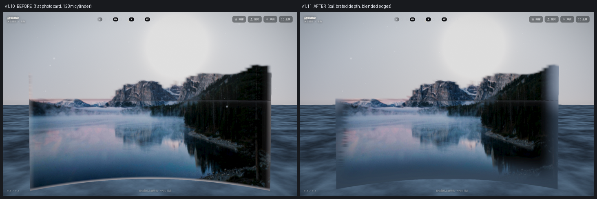

# PHOTOWORLD — 走进照片里的世界

把一张风景照片还原成"拍摄那一刻你面前的三维场景"，可以自由走动、转头、走近看。纯前端、零构建，深度推理与重建全部在浏览器本地完成，照片不上传。

## 用法

```bash
# 静态站点，任意 http 服务即可（不能直接用 file:// 打开，浏览器会阻止读取像素）
python -m http.server 8099 --bind 127.0.0.1
# 打开 http://127.0.0.1:8099/
```

- `?w=alpine|desert|coast|winter` 直接进入某个内置世界
- `?instant=1` 关闭所有过渡（截图/自动化用）
- `?skip=sky,far,near` 关闭某一层调试
- `?ring=1` 打开"视锥外程序化地平雾带"实验（**观感仍不达标，默认关闭，不建议实际开启**）
- `?x=6&z=0&yaw=0` 指定出生位置，用来对比走动视差（截图/评测用）
- 重建 A/B：`?v1=1` 回到 v1.10 的经验曲线 + 死平地面，`?flat=1` 只关近景挤出，`?vg=1.35` 调竖直夸张

操作：`WASD` 行走 · 鼠标环视（点击画面锁定指针，或按住左键拖动）· `Shift` 奔跑 · 滚轮调视野 · `Esc` 暂停 · `H` 隐藏 HUD。触屏为左半屏摇杆 + 右半屏拖动视角。

## 原理

核心是**单目深度重建**，不是把照片贴在地面上：

1. **深度估计**（`js/depth.js`）
   浏览器内跑 Depth-Anything-V2-Small（ONNX 量化版 27MB，ort-web + WASM 单线程）。图片缩放到 518×518 → 归一化 → 推理出每个像素的相对深度 → 自动判定极性（天空必须在远端）。首次加载 27MB，之后走浏览器缓存。

2. **三维表面重建**（`js/world.js` → `buildRelief`，v1.11 起）
   按 (方位角 × 仰角) 生成网格，每个顶点按自己的深度放到空间里：
   - **双锚点物理标定**：近端锚点来自地面平面几何 `z = 1.7 / (-sinφ)`，远端锚点是 520m 先验，
     解出 `z = A·(d+r0)^(-p)`。距离不再是经验曲线，也不再把 46m 外全部压到 128m 的固定圆柱
     （那正是旧版"照片平铺在背景上"的根因）。
   - 地平线**以上**：半径来自标定深度，山体/树木有真实前后关系；>160m 的四边形拆到
     `reliefBackdrop`，渲染时跟随相机平移（与 GLB 资产模式的远景层同一策略）。
   - 地平线**以下**：水平距离仍按"平地 + 1.7m 眼高"反解，但**深度会参与几何**——
     明显比同排地面基线更近的连续区域被挤成近景物体；配死区、5×5 低通、9 行低通与
     镜像接缝衰减，平坦水面保持完全水平，不会挤出一圈圈波纹条纹。行走高度场同步跟随。
   - **前拉约束**：断崖处单轮单侧吸附，地面行豁免；标定模式下阈值 1.9（距离动态范围变大后，
     1.25 会把连续地形误判成断崖）。
   - **边缘融色**：顶点带 `aEdge(vec2)`，视锥侧边把照片纹理融进天光/地面色、底边融进地面色，
     消掉"插在水面上的卡片"硬切边；视锥外不建面，避免镜像拉伸条纹。

3. **光与空气**
   太阳方位取天空最亮处，雾色取地平线色；光照在线性空间计算（sRGB 解码 → 光照 → ACES → sRGB 编码）；入景前用 64×36 探针 FBO 迭代反解曝光，让画面平均亮度对齐原片。

4. **后期**（`js/glutil.js` FS_POST）
   FXAA、暗角、极轻微颗粒。

模型不可用时自动回退到早期的"天际线 + 分层贴片"方案（`buildCurtain`），离线或加载失败也能进世界。



## 参考方案（v1.11 在 GitHub 上检索的结论）

| 仓库 | 结论 / 借鉴点 |
| --- | --- |
| `vt-vl-lab/3d-photo-inpainting`（CVPR 2020） | 单图 RGB-D → Layered Depth Image，靠**分层 + 遮挡修补**产生真视差；本项目据此拆出远景层，并明确"不要把所有像素连成一张连续曲面"。 |
| `OneeMe/splat-drawing`、`imichaelnorris/image-3d` | 浏览器内 Depth-Anything-V2 → 单图 2.5D 点云/splat；确认深度必须真正参与几何，而不是只影响颜色。 |
| `jhaabhijeet864/DepthWizard`、`AyberkA0/pbrcelain-material-generator` | Z 尺度夸张、2/98 分位裁剪、局部均衡、去 bowl/dome；用于竖直夸张与深度低通。 |
| `s-macke/VoxelSpace` | 明确写出 2.5D 高度场无法表达建筑/树木等竖直物体，只调高度系数没有用。 |
| 仓库内 `pipeline/geom.py`、`js/glbworld.js` | 双锚点地面平面标定 + 断崖跳四边形、backdrop 无视差远景层：本项目自己已验证的方案，优先移植到在线链路。 |

**没有采用的方案**：3D Gaussian Splatting（`antimatter15/splat`、`apple/ml-sharp`）与更大的度量深度后端
会破坏"零依赖 / 27MB 模型 / CPU 可跑"的约束；LDI 裙边与遮挡修补需要额外侧面几何或 inpainting，
留作下一版结构改造（见「已知限制」）。

## 两条产线

| 产线 | 何时用 | 产物 | 尺度 |
|---|---|---|---|
| **离线重建**（`pipeline/`） | 想要"能自由行走、尺度真实"的世界 | `world.glb` + `world.json` | 地面平面约束（相对深度）或度量深度 |
| **在线预览**（`js/`，本页） | 打开即用、无需等待、无需 GPU | 浏览器内实时生成 | 相对深度 + 近似尺度 |

```bash
python -m pip install onnxruntime numpy pillow
python pipeline/reconstruct.py worlds/alpine.jpg --out out/alpine   # → world.glb
```

离线管线的设计与参数见 [`pipeline/README.md`](pipeline/README.md)。

### 资产模式（加载离线产物）

```
https://…/?glb=assets/world-alpine.glb      # 直接加载 glb，跳过在线重建
```

`js/glbworld.js` 自己解析 GLB（不引入 three.js）：取出 POSITION/NORMAL/TEXCOORD_0/索引与内嵌 JPEG，
喂给现有渲染器，交互、天空、雾、曝光、FXAA 全部复用。仓库里的 `assets/world-alpine.glb`
就是 `pipeline/` 用 `worlds/alpine.jpg` 生成的样例（198,290 三角 / 5.9MB，分 2 层）。

远景层（`backdrop`）在渲染时跟随相机平移 —— 远景本就不该有视差，
这样走动时山不会"滑过来"，是消掉沙盘感的关键；近景 70m 内是真几何，视差正确。

### 多层 + 顶点色资产

`glbworld.js` 除了 `TEXCOORD_0` 也读 `COLOR_0`（VEC3/VEC4 都吃），因此**无贴图的纯顶点色 GLB 也能直接加载**：
> ?glb=xxx.glb → 没有内嵌 JPEG 时自动走顶点色材质（`mode 1`），天光取默认值。

层名约定：叫 `backdrop` 的层做无视差远景，其余层（`near` / `prop` / 任意名）按顺序合并成一条近景通道，
所以 1 层、2 层、3 层以上的产物都能走同一条渲染路径，不需要改渲染器。

资产模式会在加载时从网格顶点烘一张 2m 精度的高度图（每格取**中位数**，对"树冠抬高"和"地下尖刺"都稳），
因此离线产物不带 `world.json` 也能正常贴地行走，不会漂在半空。

## 冒烟测试

```bash
python -m http.server 8137 --bind 127.0.0.1
node tools/smoke.mjs --base http://127.0.0.1:8137            # 5 例：4 个内置世界 + 资产模式
node tools/smoke.mjs --base … --shots /tmp/smoke --only alpine
```

判据是硬的：`body[data-ready] === '1'` 且 `window.__errs` 为空、无 `data-err`，任何一例失败退出码 1。
一行改名（例如 `opts`→`opt`）就能让主路径 100% 进不去世界，这个脚本 20 秒能抓到。

不开浏览器也能跑算法回归（地面平面 / 断崖补洞 / 深度预处理 / 验收门 / 训练数据层 /
动作编码 / RoPE 等变性 / 预编码 latent / 重复定义与死代码 / 深度图缓存 / 缓存串）：

```bash
node tools/test_regression.mjs
python tools/test_regression.py            # 末尾会自动跑 P2 回归
python tools/test_regression_p2.py         # 也可单独跑世界模型部分
node tools/bump_cache.mjs --check
```

离线重建的自检分三层：贴图与 UV 错位看 PSNR，**尺度错误**看地面平面尺度门（相机眼高是绝对量），
**视场错误**必须由 `--verify-fov` 或 `--fov` 覆盖 EXIF 提供独立相机做交叉泼点。
单视图自洽自检在数学上无法约束尺度/FOV，别只看 99dB 就认为尺度对了。详见 `CHANGELOG.md`。

## 数据驱动调参

`tools/` 下是一条完整的语料 → 评测 → 调参链路（仅本地使用，不参与发布）：

```bash
python tools/harvest.py --target 520 --out corpus   # 从 360 图搜按 20 类场景抓横构图大图
python tools/normalize.py corpus                    # 统一成 420 宽基线 JPEG（Node 才能全量解码）
node tools/eval.mjs --sets baseline,strict,loose    # 多组参数在同一批图上的量化对比
```

`eval.mjs` 用 Node 里的 `jpeg-js` 解码，直接调与浏览器完全相同的 `analyzePixels`，统计地平线截断率、天空识别失效率、高度饱和率、低谷率等指标。当前默认阈值来自 503 张语料上 7 组参数的扫描结果（score 0.704 vs 基线 0.645）。

`tools/shot.mjs` 是基于 CDP 的真实等待式截图工具（等页面 `data-ready` 再截），比 `--virtual-time-budget` 可靠。

## 目录

```
index.html
css/style.css
js/mat.js          矩阵 / 随机数
js/glutil.js       着色器与 WebGL 封装
js/reconstruct.js  照片分析（analyzePixels 纯函数，浏览器与 Node 共用）
js/depth.js        深度模型推理
js/world.js        几何：深度表面重建 / 分层回退 / 程序化道具
js/renderer.js     渲染管线 + 后期 + 曝光探针
js/player.js       第一人称控制
js/audio.js        程序化风声
js/app.js          画廊 / 载入 / 主循环 / HUD
models/            Depth-Anything-V2-Small 量化 ONNX（27MB）
vendor/ort/        onnxruntime-web（WASM 单线程）
worlds/            内置场景图
train/             历史实验：早期本地小网络（deprecated，运行时无引用，见 train/README.md）
tools/             语料采集 / 归一化 / 批量评测 / CDP 截图 / 算法回归 / 缓存升版
worldmodel/        Causal World DiT（action_codec 统一训练/推理动作，data/ 读 tar 与 .latent）
CHANGELOG.md       面向使用者的更新日志
```

## 已知限制

- 单目深度是**相对深度**，不是真实测距：前端仍用经验映射（近端 ~2.5m、远端 ~250m），
  离线管线已改用地面平面 + 双锚点物理标定（上限与先验联动），两条链路的尺度模型尚未统一。
- 深度不连续处（前景遮挡背景）做单轮单侧"前拉"补洞，边缘偶有轻微拉伸；地面行豁免，
  保证 `y=0` 平面不被吸附破坏。
- 双锚点在默认 1500m 先验下 p≈2.28，深度 10% 误差会放大成距离 27.2% 误差；
  天空/远景仍会到达 1800m 上限（属 `backdrop` 无视差背景层），根治需换度量深度后端。
- 360° 背向画面靠镜像平铺补全，会出现重复的山形。
- 深度图缓存只在内存（最多 4 张）：同一会话内返回已进过的世界免推理，刷新页面后仍需重算；
  跨刷新持久化（IndexedDB）与降分辨率推理尚未做，两者都需要先按截图 A/B 确认画质损失。
- 在线重建模式的移动范围是半径 24m（`walkRadius`，v1.11 从 12m 放宽），再远就离开了照片能覆盖的信息；资产模式是 55m。
- 细密植被（草叶、树枝）深度不精确，近景可能略显"纸片感"。
- **仍是单层连续曲面**：v1.11 已消掉 128m 圆柱与硬切卡片边，但没做 LDI 裙边 / 遮挡修补，
  绕到物体侧面或走远时仍能看出照片边界；根治需要断崖处跳过四边形并生成侧面/背景补洞。
- 边缘融色只覆盖视锥内 25% 渐隐带，视锥外仍是程序化地面；360° 全铺需要 `extend_fov` 级别的外推与修补。
