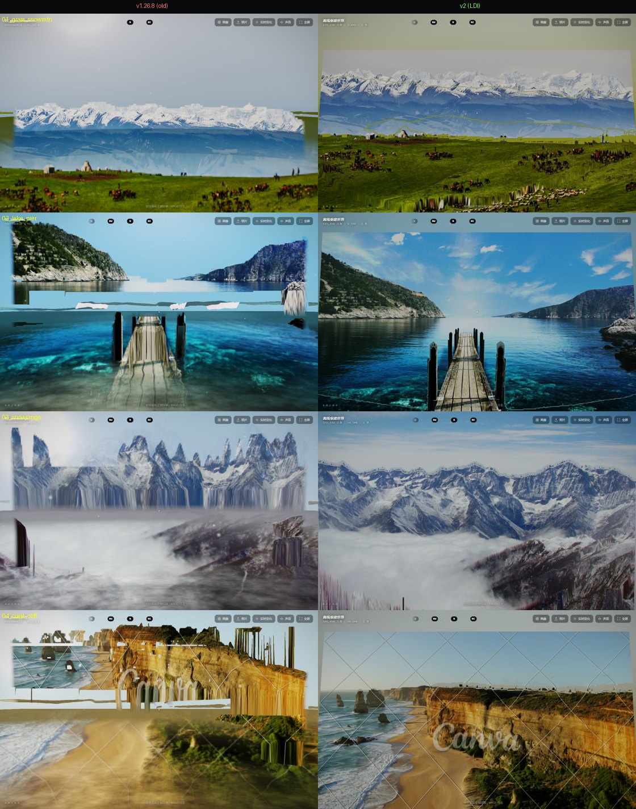
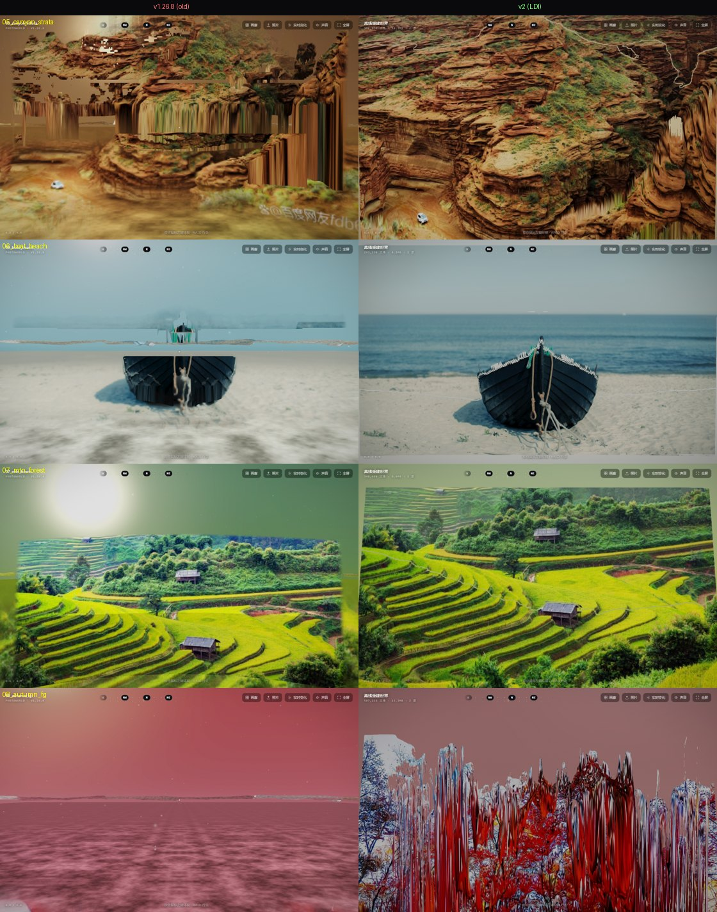
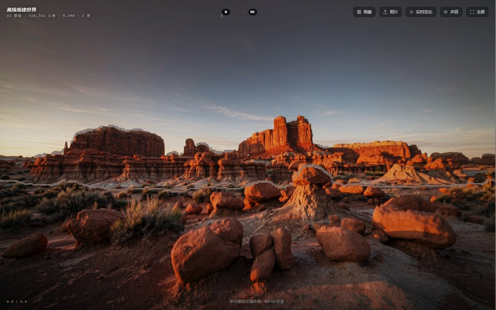

# v2 分层重建（LDI）—— 做了什么、为什么、还差什么

本文记录 v2.0.0 的结构性改造与 A/B 证据。所有结论都来自实测截图与数值，
不是设计意图的自述。

## 1. 老链路到底坏在哪

v1.26.8 的在线链路（`js/world.js` + `js/depth.js`）在实测里同时有四个问题，
它们互相叠加，任何一个单独修都不够：

| 症状 | 现场证据 | 根因 |
|---|---|---|
| 山体像"幕布/钟乳石" | `03_snowrange` 整片竖直拉丝 | 单张连续深度薄片：深度不连续处把纹理沿竖直方向拉满 |
| 山的底部有镜像倒影带 | `01_grass_snowmtn` 山体下方一整条倒影 | 全景 UV 镜像平铺（`panoU`） |
| 转身只剩一张地毯 | 同一张图 `back` 视角全是程序化地面 | 照片视锥外没有任何真实几何 |
| 秋叶整幅塌成粉色地毯 | `08_autumn_fg` 只剩一条"叶带" | 深度只有 518²（原图 1380 宽），细结构没有各自深度 |

量化一下深度学习这一条：原图 1380×740，推理分辨率 518×518，**深度分辨率只有
图像的 1/2.7**，且放大用双立方。枝叶这种几像素宽的结构必然被平均掉。

## 2. v2 的三处结构性改动

### 2.1 深度前端换成 GPU 高分辨率 + 引导上采样

`pipeline/v2/depth_gpu.py`

* Depth-Anything-V2-**Large**（ViT-L，Apache-2.0）在 5070 上跑到长边 1540（14 的整数倍），
  参数量是老 Small 的 6 倍，输入分辨率约 3 倍；
* 残差 **guided filter** 上采样（以原图为引导，O(N) 可分离实现）：深度边缘吸附到
  图像边缘，而不是被双立方糊开 3~5 像素；
* 视差归一化窗口从 2/98 分位放宽到 **0.5/99.85**：2/98 会把"最近的前景"整块削平
  （实测 `03_snowrange` 底部 15% 行里有 12.5% 像素饱和在同一个值上，几何塌成 2m 平板）。

单张推理实测约 **3.2s**（1540 长边，fp16）。

### 2.2 几何从"一张薄片"换成 LDI（分层 + 裙边）

`pipeline/v2/ldi.py`

* 按深度断崖剪四边形（沿用 v1 `geom.build_mesh` 的结构张量判据），
  **被前景遮住的地方本来就不建面**，所以不再有"拉满的幕布"；
* 沿掏空边界向后挤出**裙边**，让薄片有"厚度"：侧移时看到的是物体侧面，不是穿透的洞；
* 地面用**几何判据**压平（射线与 y=0 平面的交点距离 vs 深度），不是按画面行号 ——
  这是 REVIEW.md D1 指出的正确判据；
* 纹理拉伸超阈值（12×）的区域改用大窗口中值平滑深度，把映射均匀化。

三个被实测否掉的方案（写在这里，避免以后重复走）：

| 试过的做法 | 结果 |
|---|---|
| 等距切三层（近/中/远） | 等深线横穿平滑表面，画面中间出现一条**细缝**（人眼对直线极敏感） |
| 按断崖连通域分层 | 深度本身很连续，整幅并成一个连通域，等于没分层 |
| 深度量化成档位（1.3×） | 枝叶图的碎片没有变少，观感无改善 |

最终用的是**只切一刀**（远景 120m，落在雾霭里）+ 背景层向近景多占 1 像素盖住缝。

### 2.3 相机内参随资产走

`pipeline/glb.py` 把 `hfov/vfov/w/h/pitch` 写进 `asset.extras.camera`，
`js/glbworld.js` 读出来，`js/app.js` 灌进 `world.reliefMeta` 与 `world.analysis`，
并且资产模式把 `fovMul` 锁到 1.0。

**不接这根线的后果是可见的**：GLB 路径原本按固定 66° 渲染，而几何按照片真实视场
（69.4°）建 —— 整幅重建被放大错位，画面左右露出被拉长的贴图边缘。

## 3. A/B 证据（8 张代表图，同一机位）





左列 = v1.26.8，右列 = v2。

样本取自 `corpus/`（2895 张网图语料），覆盖雪山/湖泊/海岸/峡谷/沙滩/梯田/秋叶。
截图工具：`tools/abshots.mjs`（一次启动、复用已加载模型、每图多机位）。

| 图 | 老链路 | v2 | 结论 |
|---|---|---|---|
| 01 草地+雪山 | 山体镜像倒影带、草皮地毯 | 山体成片、草地有真实透视 | 质变 |
| 02 湖+栈桥 | 栈桥被切断、水平错位 | 栈桥/湖面/崖壁都正确 | 质变 |
| 03 雪山群 | 整片竖直拉丝 | 完整山脉 + 云海 | 质变 |
| 04 海岸崖 | 断片 + 竖条 | 崖壁/海浪/沙滩连贯 | 质变 |
| 05 峡谷岩层 | 竖直滴落、板片 | 岩层有体积、前景岩块立体 | 质变 |
| 06 沙滩木船 | 船体镜像+模糊 | 船、缆绳、沙滩都还原 | 质变 |
| 07 梯田森林 | 一张绿色卡片 | 梯田层叠、有真实纵深 | 质变 |
| 08 秋叶前景 | 整体塌成粉色地毯 | 能看到枝叶，但被撕成竖条 | **仍不合格** |

7/8 明显改善，1 例退化成另一种失败（见下）。

## 4. 已知限制（不掩饰）

1. **细枝/树叶类前景仍然失败**（`08_autumn_fg`）。深度图本身是对的（叶 1m、背景树 30m），
   但几像素内跨 30 倍的深度在网格表示里必然把四边形剪碎，剪完剩下的是竖条。
   正确的表示是**点云/splat**（仓库在线链路 v1.24.7 已有 `buildSplat`），
   需要给 GLB 加载器加 `mode=0 (POINTS)` 支持 —— 这是 v2.1 的事。
2. **只重建拍摄方向**。照片视锥外没有内容；转身看到的是天穹与雾，不是新地貌。
   这一条与 v1 相同，属于单视图重建的边界。
3. **视场靠猜时比例会偏**。没有 EXIF 的照片按 26mm 折算（69.4°）；
   错误的视场会让"竖直角"整体偏大或偏小。要根治得用能估焦距的深度后端
   （DepthPro），但那是非商用许可，没有采用。
4. **端到端约 11~15s/张**（5070，冷启动含模型加载），命中缓存后 <1s。
   想做到"打开即用"要么常驻服务，要么把深度模型换小（会损失画质）。

## 5. 怎么复现这些图

```bash
# 1) 起点：静态站 + 本地重建服务
python -m http.server 8199 --bind 127.0.0.1
cd server && python -m uvicorn app:app --host 127.0.0.1 --port 8100

# 2) 前端走 v2（服务不可用时自动回退老链路）
#    http://127.0.0.1:8199/?w=desert&api=http://127.0.0.1:8100

# 3) 离线批量烘焙 + 多机位截图
python pipeline/v2/bake.py "corpus_test/*.jpg" --out out/v2/all
node tools/abshots.mjs --base http://127.0.0.1:8199 \
  --list glb_list.txt --out shots/ab --mode glb --hw

# 4) 回归
python tools/test_v2.py            # 26 条断言，2 秒，不需要 GPU
```
