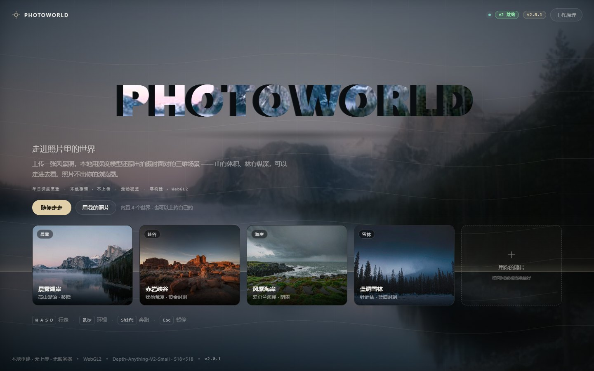
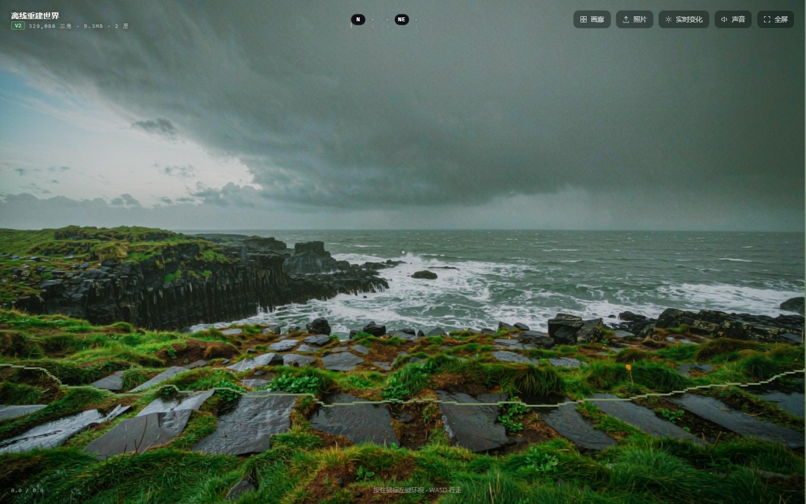

# 怎么用 GPU（WebGPU / 本地服务）拿到更好的效果

先说结论，免得看完才发现方向错了：

> **WebGPU 本身不会让画质变好。** 变好的是"把重建搬到 GPU 上跑"这件事 ——
> 分辨率能上去、几何能分层、遮挡能补。
> WebGPU 是浏览器里跑这些计算的**通道**，通道通不通取决于你的显卡被谁认领。

所以有三条路，按画质从高到低。本文每条都给可复制的步骤和**实测**数据。

---

## 0. 先花 10 秒确认自己现在在哪条路上

打开 `gpu.html`（展厅右上角那个胶囊标签也直接指向它）：

```
http://127.0.0.1:8099/gpu.html
```

它会报三件事：

| 项 | 说明 |
|---|---|
| 结论 | `v2 就绪` / `在线 · 独显` / `在线 · 核显` / `在线链路` |
| GPU 适配器 | WebGPU 实际拿到的那块卡。**写着 intel / 基本渲染驱动就是没拿到独显** |
| 本地重建服务 | `/health` 能不能连通、服务端 GPU 型号、v2 依赖是否齐全 |

展厅顶栏的胶囊标签是同一份结论的摘要：绿色 = v2，黄色 = 部分可用，红色 = 在线链路。


进世界之后左上角的 `V2` / `在线` / `资产` 标记，是**这一个世界**实际用的链路。

---

## 1. 路线一：本地 GPU 服务（画质最好）

服务端跑 Depth-Anything-V2-**Large**（长边 1540）+ LDI 分层几何，产出的是照片级世界。
只需一块 CUDA 显卡（笔记本 8GB 显存够用）。

```bash
# 依赖（前端仍然零构建，这些只是服务端要的）
python -m pip install torch transformers scipy pillow numpy fastapi uvicorn

# 权重约 1.3GB：HF 直连在国内常被墙，用镜像
export HF_ENDPOINT=https://hf-mirror.com
mkdir -p models/da2_large
for f in config.json preprocessor_config.json; do
  curl -sL -o models/da2_large/$f \
    "https://hf-mirror.com/depth-anything/Depth-Anything-V2-Large-hf/resolve/main/$f"
done
curl -L -C - --retry 20 --retry-all-errors \
  -o models/da2_large/model.safetensors \
  "https://hf-mirror.com/depth-anything/Depth-Anything-V2-Large-hf/resolve/main/model.safetensors"

# 起服务
cd server && python -m uvicorn app:app --host 127.0.0.1 --port 8100

# 另开一个终端起静态站
python -m http.server 8099 --bind 127.0.0.1
```

验证与使用：

```bash
curl -s http://127.0.0.1:8100/health
# {"ok":true,...,"gpu":"NVIDIA GeForce RTX 5070 Laptop GPU",
#  "reconstruct":{"ok":true,"reason":""}}
```

```
http://127.0.0.1:8099/?api=http://127.0.0.1:8100
```

带 `?api=` 时，点任意一张照片（内置的或自己传的）都会先 POST 到服务重建；
**服务不在或失败会静默回退**到在线链路，所以这个参数加了不会让页面变脆。

实测（RTX 5070 Laptop 8GB，fp16）：

| 阶段 | 耗时 |
|---|---|
| 冷启动第一张（含 1.3GB 权重加载） | 11 ~ 15 s |
| 后续同一张（内容哈希命中） | < 0.1 s |
| 换一张新图（模型已常驻） | 6 ~ 9 s |
| 纯几何构建（不含深度推理） | ~ 1 s |

服务端会把结果按图片内容哈希缓存，所以在画廊里来回点同一张几乎零成本。
批处理用 `python pipeline/v2/bake.py`，不依赖服务。

---

## 2. 路线二：浏览器内 WebGPU（需要独显被浏览器认领）

先明确它能带来什么、不能带来什么：

**能**：在浏览器里跑更大输入尺寸的深度模型、把几何构建放到 GPU 上，省掉服务这一跳。

**不能**：单靠换个后端就变出 v2 的分层几何 —— 那部分逻辑在
`pipeline/v2/ldi.py`，目前只在服务端（Python）实现。

### 2.1 为什么"我明明有独显，适配器却是 intel"

笔记本（Optimus / 双显卡）默认把**浏览器进程**交给核显，独显只在被明确要求时才上。
命令行旗标 `--force_high_performance_gpu` 在多数情况下**不起作用** —— 实测本机：

```
WebGPU 适配器   intel / gen-12lp
WebGL 渲染器    ANGLE (Intel, Intel(R) UHD Graphics, D3D11)
```

而 `SystemInfo` 里能清楚看到 `NVIDIA GeForce RTX 5070 Laptop GPU` 存在。
也就是说"显卡有"和"浏览器能用"是两件事。

### 2.2 让浏览器用上独显（Windows）

1. 设置 → 系统 → 显示 → **显卡**（旧版叫"图形设置"）
2. 「添加桌面应用」→ 浏览到 `msedge.exe`（Chrome 就是 `chrome.exe`）
3. 选中它 → 选项 → **高性能** → 保存
4. **完全退出浏览器**（任务管理器里确认没有残留进程）再重开
5. 回到 `gpu.html`，「GPU 适配器」应该变成 `nvidia / ...`

Linux 用 `prime-run` / `DRI_PRIME=1` 起浏览器；macOS 不用管（系统自动切换）。

### 2.3 核显上别硬跑

自检页里那个算力测试是真实的内核（1M 线程 × 256 次 FMA）。本机核显实测：

```
632 GFLOPS（7ms / 8 轮） · 中低端/核显级
```

同一块机器上的独显在浏览器里拿不到，所以没有可比的浏览器实测值。
但按这个量级估算，把 27MB 的深度模型从"单线程 WASM"搬到核显 WebGPU，
收益远小于把它搬到服务端独显 —— 因为画质的瓶颈是**模型大小与输入分辨率**，
不是那 3~10 秒的推理时间。这也正是路线一更值得走的原因。

> 结论：WebGPU 值得开，但**先确认适配器是独显**；核显上它帮不了画质，
> 反而可能因为驱动差异引入渲染问题。

---

## 3. 路线三：在线链路（零安装）

不带 `?api=` 就是这条路：浏览器内 Depth-Anything-V2-Small（量化 27MB）+ ORT-WASM。
随时能用，但深度分辨率只有图片的 1/3，山脊与枝叶会糊、边缘容易出竖直条纹。
适合"只想快速看看"，不适合验收画质。

---

## 4. 画质差在哪（为什么值得折腾 GPU）

同一批照片、同一机位的新旧对比在 `docs/ab/v2_ab_1.jpg`、`docs/ab/v2_ab_2.jpg`，
逐图结论在 [`docs/AB_v2.md`](AB_v2.md)。一句话版本：

| | 在线链路 | v2 链路 |
|---|---|---|
| 深度模型 | ViT-S，518² | ViT-L，长边 1540 |
| 深度分辨率 / 图宽 | ≈ 1 : 2.7 | ≈ 1 : 1 |
| 几何 | 一层连续薄片 | 分层 + 裙边 |
| 地面 | 画面行号判据 | 射线-平面几何判据 |
| 山体 | 竖直拉丝（幕布） | 完整山脊 |
| 转身 | 程序化地毯 | 无视差背景 + 真实视差近景 |



8 张代表图里 7 张明显改善；唯一没解决的是**密集枝叶贴脸**的前景 ——
深度是对的，但几像素内跨 30 倍的深度在网格里必然被剪碎，正解是点云/splat（v2.1）。

---

## 5. 常见失败对照

| 现象 | 原因 | 处理 |
|---|---|---|
| 适配器是 intel，但机器有独显 | OS 没允许浏览器用独显 | 按 2.2 改 Windows 显卡设置，彻底重启浏览器 |
| `navigator.gpu` 有、`requestAdapter` 返回 null | 驱动/策略关闭了 WebGPU | 更新显卡驱动；在 `edge://gpu` 搜 WebGPU 看状态 |
| 服务连不上 | 端口被占 / 没起在 127.0.0.1 | 浏览器直接打开 `http://127.0.0.1:8100/health` 确认 |
| v2 依赖报"缺权重" | `models/da2_large/model.safetensors` 不在 | 按路线一的镜像命令下载（直连 huggingface.co 常被墙） |
| 改了参数但画面没变 | 静态资源缓存 / 页面没重新加载 | 用 `?cb=时间戳`，或看 `version.json` 与 `__PW_BUILD__` 是否一致 |
| 服务端报 CUDA OOM | 8GB 显存被别的进程占 | 关掉其它占显存的程序；或把 `--long-side` 调到 1036 |

诊断报告可以直接在自检页点「复制诊断报告」，里面含 UA、适配器、特性列表、
服务端 GPU 与 v2 依赖状态 —— 报问题时粘这段就够定位。
